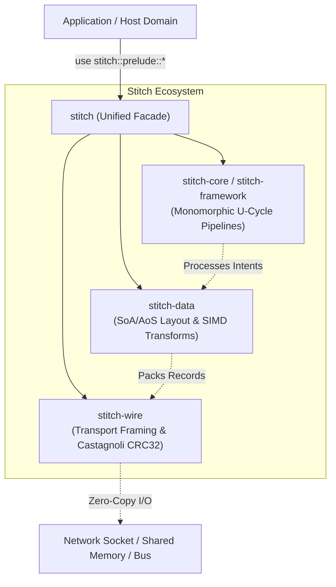

# Stitch (`stitch`)

[](https://github.com/stitch-rs/stitch/actions/workflows/ci.yml)
[](https://stitch-rs.github.io/stitch/)
[](https://crates.io/crates/stitch)
[](https://docs.rs/stitch)
[](LICENSE)
[](#architectural-axioms)

> **The Unified Systems Architecture Ecosystem for High-Performance Rust.**

`stitch` is the primary entry point and facade meta-crate for the Stitch ecosystem, seamlessly unifying execution pipelines, memory layout transformations, and wire transport into a zero-cost, mechanical-sympathy stack.

---

## Documentation

📖 Read **[The Stitch Architecture Book](https://stitch-rs.github.io/stitch/)** for the complete technical reference:

- **The Sewing Machine Architecture (SMA)**: Monomorphic U-cycle pipelines, static dispatch, and 64-byte L1D cache-line alignment.
- **Network Wire Framing**: Zero-copy 28-byte headers, SWAR magic resynchronization, hardware Castagnoli CRC-32C, and Tokio/Std streaming.
- **Columnar Data Compression**: SoA layout, Gorilla float delta-of-delta, SIMD RLE, dictionary encoding, and `SCHEMA_HASH` governance.
- **Cross-Language Interoperability**: C-ABI library (`stitch_wire.h`) with panic-safe `catch_unwind` and WebAssembly linear memory exports.
- **Production Domain Exemplars**: Complete architectural teardowns of the **HFT L2 OrderBook Gateway** and **128Hz Game State Synchronizer**.

---

## Architecture Overview

The Stitch ecosystem is organized into orthogonal layers adhering to **The Sewing Machine Architecture (SMA)** and mechanical sympathy axioms:



### Ecosystem Crates

| Crate | Role | Primary Responsibility |
| :--- | :--- | :--- |
| **[`stitch-framework`](https://github.com/stitch-rs/stitch-framework)** | Execution Kernel | Monomorphic compile-time U-cycle pipelines, CQS, Blackboard scratchpads, `#![no_std]`. |
| **[`stitch-data`](https://github.com/stitch-rs/stitch-data)** | Data & Layout Engine | Columnar block builders (SoA), bit-packing, Gorilla float compression, Delta/RLE transforms. |
| **[`stitch-wire`](https://github.com/stitch-rs/stitch-wire)** | Transport & Framing Bus | Microsecond wire frames, AVX2 streaming resync parser, hardware-accelerated Castagnoli CRC32. |
| **`stitch`** | Unified Facade | Single meta-crate providing `stitch::prelude::*`, re-exports, and seamless feature toggles. |

---

## Architectural Axioms

1. **Zero Dynamic Allocations**: Hot execution paths operate strictly within bounded scratchpads and static stack frames without heap churn.
2. **Mechanical Sympathy**: 64-byte L1D cache-line alignment prevents false sharing and cache-line boundary straddling.
3. **Strict `#![no_std]` Support**: Core kernels and framing protocols execute seamlessly on bare metal, embedded targets, and WebAssembly.
4. **Monomorphic Composition**: Static dispatch eliminates vtable indirect jumps, enabling aggressive compiler optimization and inlining.

---

## Quick Start

Add `stitch` to your `Cargo.toml`:

```toml
[dependencies]
stitch = "0.3"
```

### Complete End-to-End Pipeline

```rust
use stitch::prelude::*;

// 1. Context Blackboard aligned to 64-byte L1D cache line
#[repr(C, align(64))]
#[derive(Default)]
struct TelemetryContext {
    ingested_events: u64,
}
impl Blackboard for TelemetryContext {}
assert_blackboard_aligned!(TelemetryContext);

// 2. High-density data record with compile-time schema hash
#[derive(Record, Debug, PartialEq, Clone, Default)]
struct TelemetryEvent {
    #[stitch(codec = "varint")]
    pub node_id: u32,
    #[stitch(codec = "zigzag")]
    pub temperature_delta_c: i32,
}

// 3. Monomorphic SMA validation layer
struct ValidationLayer;
impl Layer<TelemetryContext, TelemetryEvent, TelemetryEvent, &'static str> for ValidationLayer {
    fn on_enter(
        &self,
        ctx: &mut TelemetryContext,
        intent: TelemetryEvent,
    ) -> FlowControl<TelemetryEvent, TelemetryEvent, &'static str> {
        ctx.ingested_events += 1;
        FlowControl::Proceed(intent)
    }

    fn on_exit(&self, _ctx: &mut TelemetryContext, _outcome: &mut Result<TelemetryEvent, &'static str>) {}
}

// 4. Terminal execution node
struct TerminalSink;
impl Terminal<TelemetryContext, TelemetryEvent, TelemetryEvent, &'static str> for TerminalSink {
    fn execute(
        &mut self,
        _ctx: &mut TelemetryContext,
        intent: TelemetryEvent,
    ) -> Result<TelemetryEvent, &'static str> {
        Ok(intent)
    }
}

fn main() {
    let mut ctx = TelemetryContext::default();
    let mut pipeline = Pipeline::on_terminal(TerminalSink).wrap(ValidationLayer);

    let event = TelemetryEvent { node_id: 1, temperature_delta_c: -5 };
    let processed = pipeline.dispatch(&mut ctx, event).unwrap();

    // 5. Pack directly into wire frame with hardware Castagnoli CRC32
    let mut scratch = [0u8; 64];
    let mut wire_buffer = [0u8; 128];
    let wire_len = pack_record(
        &processed,
        WireOptimizationProfile::Balanced,
        &mut scratch,
        &mut wire_buffer,
    ).unwrap();

    // 6. Unpack on receiving end with guaranteed schema verification
    let received: TelemetryEvent = unpack_record(&wire_buffer[..wire_len]).unwrap();
    assert_eq!(processed, received);
}
```

---

## Feature Flags

| Flag | Default | Description |
| :--- | :---: | :--- |
| `std` | **Yes** | Enables standard library integration (`std::io`, threading helpers). |
| `framework` | **Yes** | Enables `stitch-core` and procedural macros (`stitch::framework`). |
| `data` | **Yes** | Enables `stitch-data` layout engine and derive macros (`stitch::data`). |
| `wire` | **Yes** | Enables `stitch-wire` transport framing and CRC32 bus (`stitch::wire`). |
| `alloc` | No | Enables heap-assisted batch serialization while remaining `#![no_std]`. |
| `async` | No | Enables asynchronous pipeline traversal (`stitch-async`). |
| `full` | No | Activates all features (`std`, `framework`, `data`, `wire`, `async`). |

---

## License

Dual-licensed under either:

- Apache License, Version 2.0 ([LICENSE-APACHE](LICENSE-APACHE) or <http://www.apache.org/licenses/LICENSE-2.0>)
- MIT license ([LICENSE-MIT](LICENSE-MIT) or <http://opensource.org/licenses/MIT>)

at your option.
